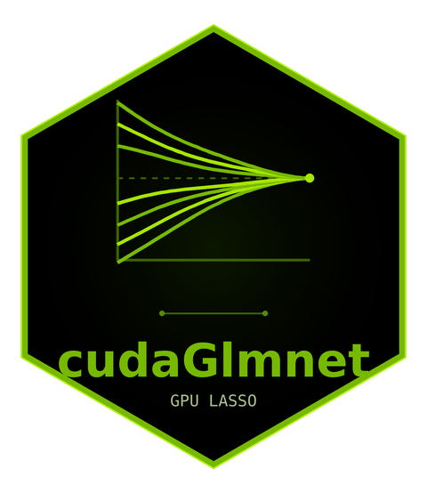

# cudaGlmnet <a href='https://github.com/shajoezhu/cudaGlmnet'></a>

<!-- start badges -->

[](https://github.com/shajoezhu/cudaGlmnet/actions/workflows/check.yaml)

A minimal **glmnet-like front end for the Gaussian lasso and elastic net**,
solved by GPU FISTA through the low-level
[rcupp](https://github.com/shajoezhu/rcupp) package. It adds a lambda path,
cross-validation, standardization and an intercept, with glmnet-style
`coef(s=)` / `predict(s=)` methods. The `alpha` argument selects lasso
(`alpha = 1`, the default), ridge (`alpha = 0`) or the elastic net in between.

If you want the raw operators/sessions instead of a glmnet-style API, use
`rcupp` directly.

## What it provides

- `cuda_glmnet()` — a full **lambda path** (`lambda_max = max|X^T y|/n`,
  divided by `alpha` for the elastic net), standardization (population scale
  `1/n`), an intercept (via centering), coefficients mapped back to the
  original scale, and glmnet style `s` selection by numeric `lambda` or
  log-lambda interpolation. `warm_start` is opt-in (default off, keeping
  cold-start fits bit-identical to one-shot).
- `cv.cuda_glmnet()` — K-fold CV with `lambda.min` / `lambda.1se`, custom
  `foldid` and user-supplied `lambda` grids.
- glmnet-style S3 methods — `coef()` / `predict()` / `print()` for
  `cuda_glmnet`, `cv.cuda_glmnet` and `cuda_lasso` objects.
- `cuda_lasso()` — the single fixed-lambda entry point, kept deliberately
  unchanged as the **numerical reference** (no intercept / standardization).
- `lasso_fista_cpu()` — a pure-R FISTA oracle with the identical numerical
  contract, used to verify the compiled path.
- `enet_fista_cpu()` — the pure-R oracle for the **standard** elastic-net
  objective the solver uses internally; reproduce a `cuda_glmnet(λ, α)` fit by
  passing the remapped `(λ_c, α_c)` (see below).

For `alpha = 1` a whole lambda path (and each CV fold) runs through **one
`rcupp` lasso session**: `X`/`y` are uploaded to the device once and the
cached Lipschitz constant is reused across every lambda. For `alpha < 1` the
elastic-net loop lives in this package's own `src/` (Rcpp glue plus rcupp
substrate) and composes rcupp's **resident device operators**, so data stays
on the device across the whole solver loop. In both cases repeated-fit
workloads avoid a host-device round trip per operator, and rcupp itself stays
algorithm-agnostic.

## Installation

`cudaGlmnet` depends on `rcupp` at run time (declared in `Imports` and
`Remotes: shajoezhu/rcupp`). Install `rcupp` first (or let `remotes` pull it
from GitHub):

```r
# install.packages("remotes")
remotes::install_github("shajoezhu/rcupp")
remotes::install_github("shajoezhu/cudaGlmnet")
```

CUDA is **optional** — it is inherited from how `rcupp` was built. With a GPU
`rcupp` you get `backend = "cuda"`; with the CPU fallback you get
`"cpu-shim"`. All fits run and give identical numerics either way.

## Quick start

```r
library(cudaGlmnet)
set.seed(1)
X <- matrix(rnorm(60 * 5), 60, 5)
y <- drop(X %*% c(2, -1, 0, 0, 0)) + rnorm(60, sd = 0.5)

# Full lambda path (lasso)
fit <- cuda_glmnet(X, y, nlambda = 10)
coef(fit, s = fit$lambda[5])                # coefficients at one lambda
predict(fit, X[1:3, ], s = fit$lambda[5])   # predictions at one lambda

# Elastic net / ridge (alpha = 1 is the lasso, alpha = 0 is pure ridge)
en <- cuda_glmnet(X, y, alpha = 0.5, nlambda = 10)
coef(en, s = en$lambda[5])

# Cross-validation
cv <- cv.cuda_glmnet(X, y, nlambda = 8, nfolds = 3)
cv$lambda.min
coef(cv, s = "lambda.1se")

# Single fixed-lambda numerical reference + pure-R oracle
ref <- cuda_lasso(X, y, lambda = 0.05)
max(abs(coef(ref) - lasso_fista_cpu(X, y, 0.05)$coefficients))  # ~0
```

## Scope and numerical notes

- Gaussian family, dense `x`, GPU FISTA. Elastic net (`alpha`) is supported;
  `alpha = 1` keeps the lasso path bit-identical to earlier versions, while
  `alpha < 1` is composed downstream from rcupp resident device operators
  (rcupp itself stays algorithm-agnostic). Not yet: binomial, sparse `x`,
  closed-form / SVD ridge paths.
- Optional framework adapters expose the Gaussian solver to mlr3, parsnip and
  SuperLearner; all are `Suggests`-only, registered lazily at load time, and
  Gaussian-only (`obsWeights` is ignored). See the `engines` vignette. A
  standalone CV-based SuperLearner learner also lives in the separate
  `SLrcupp` package (`SL.rcupp`), which selects `lambda.min` / `lambda.1se`
  via `cv.cuda_glmnet()`; the in-package `SL.cudaGlmnet` is a thinner wrapper
  predicting at a single penalty. Both are kept intentionally.
- `lambda` / `alpha` for `alpha < 1` are in **glmnet's convention**: glmnet fits
  on an RMS-standardised response (`y/s`, `s = sqrt(mean(y²))`) and reports
  coefficients in raw-y units, so its ridge penalty carries an extra `1/s` that
  the lasso penalty does not. `cuda_glmnet()` keeps its clean standard objective
  internally and maps `α_c = sα/(1−α+sα)`, `λ_c = λ(1−α+sα)/s`, so a given
  `(λ, α)` reproduces `glmnet::glmnet(λ, α)` (~1e-6 with default tolerances).
  A scalar rescaling of `λ` alone cannot work for `0 < α < 1`. At `α = 1` the
  map is the identity (lasso unchanged). This is a **breaking change** from
  versions before 0.0.0.9015, where `λ`/`α` fed the standard objective directly.
- Older benchmarks compare against the **pure-R** FISTA oracle, not glmnet's
  compiled Fortran; read their speedups accordingly. New fair-comparison
  (`benchmark/fair_competitors.R`) and subset-ridge scripts add glmnet/real
  competitor baselines. GPU acceleration is real but workload-specific
  (repeated `p >> n` closed-form subset solves win; generic lasso paths lose to
  glmnet Fortran).
- A comparison vignette (`gpu-lasso-comparison`) contrasts with
  `cuda.ml::cuda_ml_lasso()` and `gputools`; `cuda.ml` is an optional `Suggests`
  and the vignette skips gracefully when it (or its RAPIDS runtime) is absent.
  A `getting-started` vignette covers the basic API.

## Part of the cudaGlmnet family

| Package | Role | Link |
|---|---|---|
| rcupp | low-level Rcpp/CUDA bridge + reusable operator/session framework | [github](https://github.com/shajoezhu/rcupp) |
| **cudaGlmnet** | glmnet-style GPU lasso / elastic-net front end (Rcpp + rcupp) | this repo |
| cudaBio | PCA / GWAS power iteration (`p >> n`) downstream example | [github](https://github.com/shajoezhu/cudaBio) |
| cudaFin | rolling-window lasso forecasting downstream example | [github](https://github.com/shajoezhu/cudaFin) |
| SLrcupp | standalone CV-based SuperLearner `SL.*` adapter (`SL.rcupp`) | [github](https://github.com/shajoezhu/SLrcupp) |

## License

Apache License 2.0.
